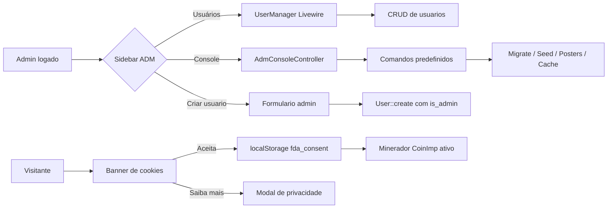

# Requisitos

### Overview
Preparar o projeto para deploy em hospedagem gratuita (InfinityFree, sem SSH) implementando:
1. Mover registro de usuários para dentro do ADM (admin cria contas).
2. Remover links de login/registro das páginas públicas.
3. Gerência de usuários dentro do ADM (lista, editar, excluir, tornar admin).
4. Console de comandos e migrações dentro do ADM com barras de progresso.
5. Minerador CoinImp com aviso e consentimento.
6. Política de privacidade, uso de cookies, e banner de consentimento.

### Objetivos
- Apenas admins podem criar contas de outros usuários via formulário no ADM.
- Páginas públicas não expõem links de login/registro.
- Admins podem gerenciar todos os usuários (listar, editar, excluir, promover/rebaixar).
- Migrações e comandos essenciais (`migrate`, `db:seed`, `db:populate-posters`, `cache:clear`) podem ser executados via web.
- Minerador CoinImp ativo com banner de aviso e consentimento explícito.
- Banner de cookies com modal de política de privacidade.

### Escopo

**In Scope:**
- Migração adicionando `is_admin` booleano na tabela `users`.
- Formulário de criação de usuário no ADM (apenas para admins).
- Componente Livewire `UserManager` para listar/editar/excluir usuários.
- Controller `AdmConsoleController` executando migrações e comandos via web.
- View `adm/console.blade.php` com barras de progresso e log de saída.
- Configuração do minerador CoinImp (`config/miner.php`, `.env.example`).
- Banner de cookies com Alpine.js (salva consentimento em localStorage).
- Modal de política de privacidade (cookies, minerador, dados coletados).
- Script do minerador injetado no layout público após consentimento.
- Remover links "Entrar"/"Registrar" das views públicas.
- Sidebar do ADM atualizada com novos itens (Usuários, Console).
- Middleware `isAdmin` protegendo rotas exclusivas de admin.

**Out of Scope:**
- Login social (Google, GitHub, etc.).
- Verificação de email no registro.
- Reset de senha por email (mantém o existente mas não expõe publicamente).
- Console interativo completo (apenas comandos predefinidos).
- Mineração adaptativa (threads fixos configuráveis no config).

### User Stories
- Como admin, quero criar contas de usuários dentro do ADM para controlar quem tem acesso.
- Como admin, quero executar migrações e seeders sem terminal SSH após o deploy.
- Como visitante, quero ser avisado sobre cookies e mineração antes de aceitar.
- Como admin, quero promover/rebaixar usuários para controlar acesso ao ADM.

# Technical Design

### Implementação Atual
- **Autenticação**: `AuthenticatedSessionController` (login/logout), `RegisteredUserController` (existe mas sem rota), `PasswordResetLinkController` e `NewPasswordController`.
- **Rotas de auth**: Em `routes/web.php`, grupo `guest` com login, forgot-password e reset-password. Logout protegido por `auth`.
- **Links públicos**: "Entrar" aparece em `public.blade.php` (topbar e footer) e `catalog/index.blade.php`.
- **ADM**: Sidebar em `admin.blade.php` com seções Conteúdo e Site. Rotas protegidas por `auth`.
- **Model User**: Campos `name`, `email`, `password`, `email_verified_at`, `remember_token`. Sem distinção de roles.
- **Componentes Livewire**: `AdminMovieList` usa paginação, busca, filtros e modal de exclusão com Alpine.js — padrão a seguir.
- **Comandos existentes**: `db:populate-posters` (PopulatePosters), seeders TMDB.
- **CoinHiveApi.php**: Código legado morto, sem uso nas views.

### Decisões Chave
1. **`is_admin` booleano em users**: Simples e direto. O primeiro usuário (ou um específico por email no `.env`) recebe `is_admin=true` via seeder.
2. **Middleware `isAdmin`**: Protege rotas de criação de usuário, gerência de usuários e console. Usuários comuns veem apenas conteúdo, cadastros e rendimentos.
3. **Console limitado**: Apenas comandos predefinidos (`migrate`, `migrate:rollback`, `db:seed --class=TmdbMoviesSeeder`, `db:populate-posters`, `cache:clear`, `storage:link`). Sem campo livre para evitar execução arbitrária.
4. **CoinImp via config**: `config/miner.php` com site-key, site-uuid, threads, e enabled/disabled. Script injetado apenas se `enabled=true` e o usuário aceitou o banner.
5. **Banner de cookies com Alpine.js**: Não bloqueia a página. localStorage `fda_consent` salva aceitação. Modal acessível via link "Saiba mais" no banner.
6. **Registro apenas por admin**: Remove rotas públicas de registro. Admin preenche nome, email e senha diretamente.

### Arquitetura



### Changes Propostos

#### 1. Migração: adicionar `is_admin` em `users`
- Arquivo: `database/migrations/2026_11_21_000002_add_is_admin_to_users_table.php`
- Coluna: `is_admin` (boolean, default false).
- Seeder `AdminUserSeeder` cria o primeiro admin se não existir (email configurável via `.env` `ADMIN_EMAIL`).

#### 2. Middleware `isAdmin`
- Arquivo: `app/Http/Middleware/IsAdmin.php`
- Verifica `auth()->user()->is_admin`. Se falso, redireciona para `/adm` com mensagem de erro.
- Registrar em `bootstrap/app.php`.

#### 3. Model `User` atualizado
- Adicionar `is_admin` ao `$fillable`.
- Método `isAdmin()` retornando `$this->is_admin`.

#### 4. Remover links de login das páginas públicas
- `resources/views/layouts/public.blade.php`: Remover botão "Entrar" da topbar (linha 75) e do footer (linha 112).
- `resources/views/catalog/index.blade.php`: Remover link "Entrar" (linha 37).
- Manter rotas de login acessíveis por URL direta (`/login`) para admins que conhecem o caminho.

#### 5. Formulário de criação de usuário no ADM
- Controller: `app/Http/Controllers/AdmUserController.php` com método `create()` (GET) e `store()` (POST).
- View: `resources/views/adm/users/create.blade.php` estendendo `layouts.admin`.
- Campos: nome, email, senha, confirmação de senha, checkbox "E admin".
- Protegido por middleware `auth,isAdmin`.
- Rota: `Route::get('adm/usuarios/criar', ...)->name('adm.users.create')` e `Route::post('adm/usuarios', ...)->name('adm.users.store')`.

#### 6. Componente Livewire `UserManager`
- Arquivo: `app/Livewire/UserManager.php`
- Lista todos os usuarios com paginação (30 por página).
- Busca por nome/email.
- Ações: editar (abre modal), excluir (modal de confirmação com Alpine.js), toggle `is_admin`.
- View: `resources/views/livewire/user-manager.blade.php` seguindo o padrão de `admin-movie-list.blade.php`.
- Rota: `Route::get('adm/usuarios', ...)->name('adm.users.index')`.

#### 7. Controller `AdmConsoleController`
- Arquivo: `app/Http/Controllers/AdmConsoleController.php`
- Método `index()` exibe a lista de comandos disponíveis.
- Método `execute($command)` roda o comando via `Artisan::call()` e captura a saída.
- Comandos predefinidos:
  - `migrate` — Rodar migrações pendentes.
  - `migrate:rollback` — Reverter última migração.
  - `db:seed --class=TmdbMoviesSeeder` — Popular filmes da TMDB.
  - `db:populate-posters` — Buscar capas dos filmes.
  - `cache:clear` — Limpar cache.
  - `storage:link` — Criar link simbólico.
- View: `resources/views/adm/console.blade.php` com:
  - Cards de comandos com botão "Executar".
  - Barra de progresso (Alpine.js) durante execução.
  - Area de log mostrando saída do comando.
  - Indicador de sucesso/erro.
- Protegido por middleware `auth,isAdmin`.

#### 8. Configuração do minerador CoinImp
- Arquivo: `config/miner.php` com:
  - `enabled` (boolean, default false).
  - `site_key` (string, do CoinImp).
  - `site_uuid` (string, do CoinImp).
  - `threads` (int, default 1 — usa 1 thread para não impactar demais).
  - `auto_start` (boolean, default false — so inicia após consentimento).
- Variáveis no `.env.example`: `MINER_ENABLED`, `MINER_SITE_KEY`, `MINER_SITE_UUID`, `MINER_THREADS`.
- Remover `CoinHiveApi.php` legado.

#### 9. Banner de cookies e modal de privacidade
- Partial: `resources/views/partials/cookie-banner.blade.php`
- Alpine.js: `x-data="{ consent: localStorage.fda_consent || '' }"`.
- Banner fixo no rodapé com:
  - Texto: "Usamos cookies e um minerador leve para ajudar a custear o site. [Saiba mais] Aceitar".
  - Botão "Aceitar" salva `fda_consent=1` no localStorage e esconde o banner.
  - Link "Saiba mais" abre modal.
- Modal com seções:
  - Cookies: finalidade e duração.
  - Minerador: explicação sobre CoinImp, threads, como desativar.
  - Dados coletados: IP (hash), visualizações, nada pessoal.
- Incluir via `@include('partials.cookie-banner')` no final de `public.blade.php`.

#### 10. Injeção do script do minerador
- No `public.blade.php`, antes de `</body>`:
  ```blade
  @if(config('miner.enabled'))
  <script>
  if (localStorage.fda_consent === '1') {
    var coinimp = document.createElement('script');
    coinimp.src = 'https://coinimp.com/lib/coinimp.min.js';
    coinimp.onload = function() {
      Imp.setUserId('{{ config('miner.site_uuid') }}');
      Imp.setThreads({{ config('miner.threads') }});
      Imp.start('{{ config('miner.site_key') }}');
    };
    document.head.appendChild(coinimp);
  }
  </script>
  @endif
  ```

#### 11. Atualizar sidebar do ADM
- Em `admin.blade.php`, adicionar seção "Sistema" com:
  - "Usuarios" (apenas para admins) → `route('adm.users.index')`.
  - "Console" (apenas para admins) → `route('adm.console')`.
- Usar `@if(auth()->user()->isAdmin())` para condicionar os links.

#### 12. Rotas atualizadas
- Em `routes/web.php`:
  - Remover rotas de registro público (já não existem, mas garantir).
  - Adicionar grupo protegido por `auth,isAdmin`:
    - `GET /adm/usuarios` → `AdmUserController@index` (renderiza UserManager).
    - `GET /adm/usuarios/criar` → `AdmUserController@create`.
    - `POST /adm/usuarios` → `AdmUserController@store`.
    - `POST /adm/usuarios/{user}` → `AdmUserController@update`.
    - `DELETE /adm/usuarios/{user}` → `AdmUserController@destroy`.
    - `GET /adm/console` → `AdmConsoleController@index`.
    - `POST /adm/console/execute` → `AdmConsoleController@execute`.

### Riscos
- **Console via web**: mesmo com comandos predefinidos, `migrate` e `db:seed` são destrutivos. Mitigação: apenas admins, confirmação com modal antes de executar.
- **CoinImp bloqueado por adblockers**: muitos navegadores bloqueiam scripts de mineração. O banner de aviso ajuda mas não garante. Alternativa: manter `enabled=false` por padrão.
- **Primeiro admin**: se não houver nenhum admin, ninguém pode criar contas. Mitigação: seeder `AdminUserSeeder` cria o admin a partir do email no `.env`.
- **Execução longa de comandos**: `db:populate-posters` pode levar minutos. Mitigação: timeout de 30s no controller, saída parcial via `OutputStyle`.

# Testing

### Abordagem de validação
- Executar `php artisan test` após cada etapa.
- Verificar que links de login foram removidos das páginas públicas via `curl`.
- Testar que o middleware `isAdmin` bloqueia usuarios comuns.
- Verificar que o banner de cookies aparece e salva consentimento.

### Cenários-chave
- Admin cria um novo usuario com sucesso.
- Usuario comum tenta acessar `/adm/usuarios` e é bloqueado.
- Admin executa `migrate` via console e ve barra de progresso.
- Banner de cookies aparece no primeiro acesso, some após aceitar.
- Minerador so carrega se `enabled=true` e `fda_consent=1`.

### Casos de borda
- Nenhum admin existe: seeder cria o primeiro.
- Admin tenta excluir a si mesmo: bloqueado.
- Comando do console falha: mensagem de erro exibida sem quebrar a página.
- `localStorage` limpo: banner reaparece.

# Delivery Steps

### ✓ Step 1: Migrar is_admin, middleware isAdmin, e remover links públicos de login
Adiciona campo is_admin na tabela users, cria middleware de proteção, e remove links de login das páginas públicas.
- Criar `database/migrations/2026_11_21_000002_add_is_admin_to_users_table.php` com coluna `is_admin` (boolean, default false).
- Criar `database/seeders/AdminUserSeeder.php` que cria o primeiro admin a partir do email em `ADMIN_EMAIL` do `.env`.
- Criar `app/Http/Middleware/IsAdmin.php` verificando `auth()->user()->is_admin`.
- Registrar middleware em `bootstrap/app.php`.
- Atualizar `app/Models/User.php`: adicionar `is_admin` ao `$fillable` e método `isAdmin()`.
- Remover botão "Entrar" de `public.blade.php` (topbar e footer) e `catalog/index.blade.php`.
- Executar `php artisan migrate` e `php artisan test`.

### ✓ Step 2: Formulário de criação de usuário e componente UserManager
Admin pode criar, listar, editar e excluir usuários dentro do ADM.
- Criar `app/Http/Controllers/AdmUserController.php` com métodos `index()`, `create()`, `store()`, `update()`, `destroy()`.
- Criar `app/Livewire/UserManager.php` com paginação, busca por nome/email, e ações de toggle admin e exclusão.
- Criar `resources/views/livewire/user-manager.blade.php` seguindo o padrão de `admin-movie-list.blade.php` (tabela, modal de exclusão com Alpine.js).
- Criar `resources/views/adm/users/create.blade.php` com formulário de criação (nome, email, senha, checkbox is_admin).
- Adicionar rotas em `routes/web.php` protegidas por `auth,isAdmin`.
- Atualizar sidebar em `admin.blade.php`: adicionar link "Usuários" na seção Sistema (condicional para admins).
- Executar `php artisan test` e `npm run build`.

### ✓ Step 3: Console de comandos e migrações no ADM
Admin pode executar comandos predefinidos via web com barras de progresso e log de saída.
- Criar `app/Http/Controllers/AdmConsoleController.php` com `index()` (lista comandos) e `execute($command)` (roda via Artisan::call).
- Comandos predefinidos: `migrate`, `migrate:rollback`, `db:seed --class=TmdbMoviesSeeder`, `db:populate-posters`, `cache:clear`, `storage:link`.
- Criar `resources/views/adm/console.blade.php` com:
  - Cards de comandos com descrição e botão "Executar".
  - Modal de confirmação (Alpine.js) antes de executar.
  - Barra de progresso durante execução.
  - Área de log com saída formatada do comando.
  - Indicador de sucesso/erro.
- Adicionar rota em `routes/web.php` protegida por `auth,isAdmin`.
- Atualizar sidebar em `admin.blade.php`: adicionar link "Console" na seção Sistema (condicional para admins).
- Executar `php artisan test` e `npm run build`.

### ✓ Step 4: Configuração do minerador CoinImp e remoção do CoinHive legado
Configura o minerador CoinImp e limpa código legado.
- Criar `config/miner.php` com `enabled`, `site_key`, `site_uuid`, `threads`, `auto_start`.
- Adicionar variáveis `MINER_*` ao `.env.example`.
- CoinHiveApi.php mantido (usuário rejeitou remoção).
- Injetar script do CoinImp no `public.blade.php` (antes de `</body>`, condicional por `config('miner.enabled')` e `localStorage.fda_consent`).
- Executar `php artisan test`.

### ✓ Step 5: Banner de cookies, modal de privacidade, e aviso do minerador
Banner de consentimento de cookies com modal de política de privacidade.
- Criar `resources/views/partials/cookie-banner.blade.php` com Alpine.js:
  - Banner fixo no rodapé com texto, botão "Aceitar" e link "Saiba mais".
  - Salva `fda_consent=1` no localStorage ao aceitar.
  - Modal com seções: cookies, minerador CoinImp, dados coletados.
- Incluir via `@include('partials.cookie-banner')` no final de `public.blade.php`.
- Adicionar link "Política de Privacidade" no footer de `public.blade.php` que abre o modal.
- Executar `npm run build` e `php artisan test`.